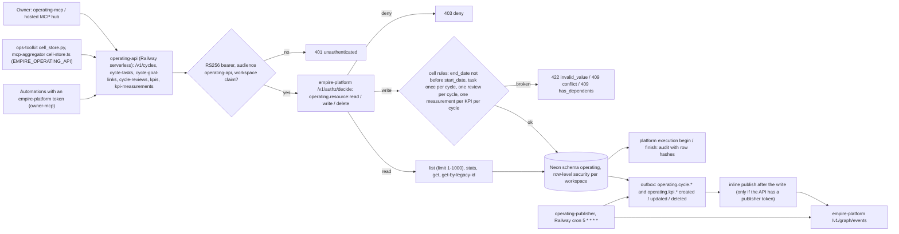

# 01 — Business process (As-Is / To-Be)

life-operating-cycles-api คือ cell "Operating rhythm" ที่เก็บรอบการทำงาน (sprint, weekly, planning, review) พร้อมงานที่ commit ในแต่ละรอบ, goal ที่รอบนั้นรับใช้, review หนึ่งครั้งต่อรอบ และ KPI ที่วัดหนึ่งครั้งต่อรอบ owner และ automation เรียกผ่าน API ด้วย token ของ empire-platform ส่วน cell ส่ง graph events ของ cycle และ KPI ไปที่ platform

Last reviewed: 2026-11-27 · commit `22bec0f`

## As-Is (จากโค้ดวันนี้)

Sources: `cell.yaml`, `.railway/railway.ts`, `pyproject.toml` (platform-cellkit v1.0.11: `cellkit/app.py`, `cellkit/auth.py`, `cellkit/publisher.py`, `cellkit/server.py`), `README.md`, `PRODUCT.md`

ข้อเท็จจริงสำคัญจากโค้ด:

- เฉพาะ `cycle` และ `kpi` มี `graph` ใน `cell.yaml` จึงเขียน outbox; cycle-task, cycle-goal-link, cycle-review และ kpi-measurement ไม่ส่ง event
- การสร้างแบบ import (มี `legacy_id`) ต้องมีสิทธิ์ `operating.<resource>:admin` เพิ่มจาก `:write`; create รับ `Idempotency-Key`, patch ใช้ `expected_version`
- owner token (ไม่มี delegation) อายุได้ไม่เกิน 1 ชั่วโมง, delegated token ไม่เกิน 30 วัน
- cell ไม่คำนวณค่า KPI หรือสถานะ (ผู้เรียกส่งมาเอง) และไม่ตรวจว่า `task_id` / `goal_id` มีอยู่จริงใน cell อื่น
- API มี publisher token สำหรับ inline publish หรือไม่: README ระบุ `OPERATING_PUBLISHER_TOKEN` เฉพาะ publisher [ต้องยืนยัน]; ถ้าไม่มี event จะรอ cron รอบถัดไป
- การตรวจ `X-Gateway-Assertion` (edge gateway) เปิดตาม `GATEWAY_ASSERTION_MODE`; ค่าใน production [ต้องยืนยัน]

## To-Be (จาก PRODUCT.md §Measures)

ไม่มี spec ที่ค้างอยู่ (`specs/001-l2-baseline` approved และ implement แล้ว) และไม่มีภาพกระบวนการเป้าหมายที่เขียนไว้ สิ่งที่เขียนไว้มีเพียง measures ที่ "Proposed, nothing collects them yet":

- cycle ที่ปิดแล้วทุกรอบมี review (เป้า: ทั้งหมด)
- KPI มี measurement ของรอบที่ปิดล่าสุด
- 5xx rate และ p95 latency ของ `/v1/cycles` (Sentry และ uptime worker)

## Gap

| ID | As-Is → To-Be | Status | Owner | Evidence |
|---|---|---|---|---|
| G1 | `PRODUCT.md` บอกว่า publisher cron ทุก 15 นาที แต่ `.railway/railway.ts` ตั้ง `5 * * * *` (ชั่วโมงละครั้ง) → เอกสารตรงกับ config | todo | claude | `PRODUCT.md` §Operating Context; `.railway/railway.ts` |
| G2 | measures เป็นแค่ข้อเสนอ ไม่มีอะไรเก็บ → owner อนุมัติ measures และเลือกที่เก็บ | decide | owner | `PRODUCT.md` §Measures |
| G3 | ไม่มี To-Be ของกระบวนการ (เช่น การวางแผนรอบ, การคำนวณ KPI) → owner กำหนด | decide | owner | ไม่มีใน `PRODUCT.md` / `specs/` |

## Open questions

- มีหน้าเว็บที่แสดง cycles หรือ KPIs หรือไม่ (`PRODUCT.md` ระบุ [ต้องยืนยัน])
